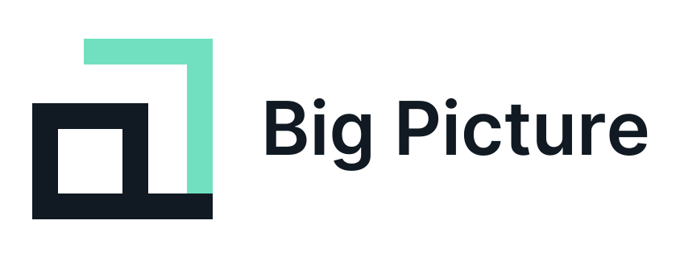
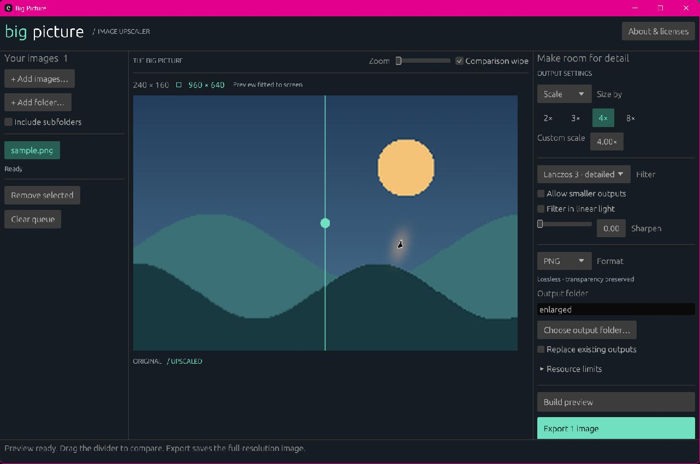

<p align="center">
  <picture>
    <source media="(prefers-color-scheme: dark)" srcset="docs/branding/big-picture-logo-dark.svg">
    
  </picture>
</p>

# Big Picture

An open-source Rust image upscaler with a command-line interface and a native
desktop application. Simple and Advanced modes work offline. Optional desktop
**AI Enhancement** edits a single selected image through OpenAI using your own
API key, with cloud uploads and API charges. No AI weights are downloaded.



Local upscaling interpolates existing pixels. AI Enhancement can clean up noise,
clarify details, enhance colours and exposure, and follow additional instructions.
AI can alter or invent details; review the comparison before saving.

## What it does

- Single images, multiple files, quoted globs, and recursive folder batches.
- 0.25× / 0.5× / 2× / 3× / 4× / 8× presets, fractional scales, width/height, aspect-preserving
  bounding boxes, and explicit exact-size stretching.
- Nearest, bilinear, Catmull–Rom, Mitchell, and Lanczos 3 filters powered by
  `fast_image_resize`, with alpha-aware filtering, optional linear light and sharpening.
- PNG, JPEG, WebP, TIFF, and BMP input/output. PNG is the default; WebP is lossless.
- Desktop queue, drag and drop, before/after wipe, preview zoom, per-file
  results, cancellation, native file dialogs, and saved preferences.
- Simple desktop mode: choose an image and ratio, then export quality-100 JPEGs
  with every algorithm. Defaults to 2× and your system Photos/Pictures folder
  on each launch, with timestamped names, a retained queue, and an **Open folder**
  button after export.
- CLI dry runs, JSON, shell completions, meaningful exit codes, and Ctrl+C.
- Single-image AI Enhancement with scale including 1×, cleanup/detail/colour/
  exposure controls, Subtle/Balanced/Creative enhancement, optional prompt and
  Standard/High quality. Generate makes one paid request; Save reuses the full
  result locally. API keys stay outside preferences; optionally remember a key
  in the OS credential store. Prompts remain session-only. Choose lossless PNG/
  WebP or quality-100 JPEG; the filename extension follows the selected format.
- EXIF orientation, input/output limits, source protection, collision detection,
  and atomic output-file replacement.

## Run it

Install [Rust](https://www.rust-lang.org/tools/install) 1.88 or later, including
the native build tools for your operating system. Windows needs the MSVC C++
build tools. Linux GUI build dependencies are described in [CONTRIBUTING.md](CONTRIBUTING.md).

```sh
# Desktop app (also accepts image paths after --)
cargo run --release --bin big-picture-gui

# CLI: 4× PNG output beside the input
cargo run --release -- upscale photo.jpg --scale 4

# CLI: a particular output and filter
cargo run --release -- upscale sprite.png --scale 4 --filter nearest -o sprite-large.png

# CLI: fit within 3840×2160, preserving aspect ratio
cargo run --release -- upscale photo.jpg --width 3840 --height 2160 -o large.png

# Batch: recurse, skip the output tree, and preview the plan first
cargo run --release -- upscale photos --recursive --output-dir enlarged --dry-run
cargo run --release -- upscale photos --recursive --output-dir enlarged --keep-going
```

Build both executables with `cargo build --release --locked --bins`. They live
in `target/release` (`.exe` on Windows). After installing with
`cargo install --path . --locked`, use `big-picture` and `big-picture-gui` directly.
Use `cargo install --path . --locked --no-default-features --bin big-picture`
for a CLI-only installation with no GUI dependency.

Large CLI outputs may need `--memory-mib 1024` or more. The default 512 MiB is a
conservative working-memory estimate, not an operating-system quota.

The bundled sample is [Merlin](docs/samples/merlin.jpg), supplied by Dave. The
1200×900 copy preserves the full composition and has source metadata removed;
it is small enough for a practical 2× enhancement. Open it with **Choose image**
or **Add images**. `cargo run --example generate_sample -- target/sample.png`
exports the same sample as PNG. Portable packages include it under `docs/samples`.

## Image rights

Big Picture is MIT licensed and adds no royalties or restrictions to its output
images. AI Enhancement also involves OpenAI's applicable terms and policies.
Commercial and non-commercial output use is permitted to the extent
you have the necessary rights to the input. Upscaling does not clear rights in
someone else's artwork, photos, logos, or depicted content. The chosen software
libraries use permissive licenses; font notices also accompany binary distribution.
See [the licensing policy and upstream links](docs/LICENSING.md).

## Documentation

- [CLI reference and automation examples](docs/CLI.md)
- [Desktop guide](docs/GUI.md)
- [Formats, quality, metadata and limitations](docs/IMAGE_BEHAVIOR.md)
- [Architecture and safety model](docs/ARCHITECTURE.md)
- [Development, tests and release packaging](CONTRIBUTING.md)
- [Validation record](docs/VALIDATION.md)
- [Changelog](CHANGELOG.md)

## Verify

```sh
cargo fmt --check
cargo clippy --all-targets --all-features --locked -- -D warnings
cargo test --all-targets --all-features --locked
cargo test --no-default-features --locked
cargo doc --no-deps --all-features --locked
```

CI is configured for Windows, macOS and Linux, plus CLI-only, minimum-Rust,
formatting, lint, documentation, and dependency-license checks. A local Windows
validation is recorded separately; configuring CI does not claim those other
platforms have already passed.
